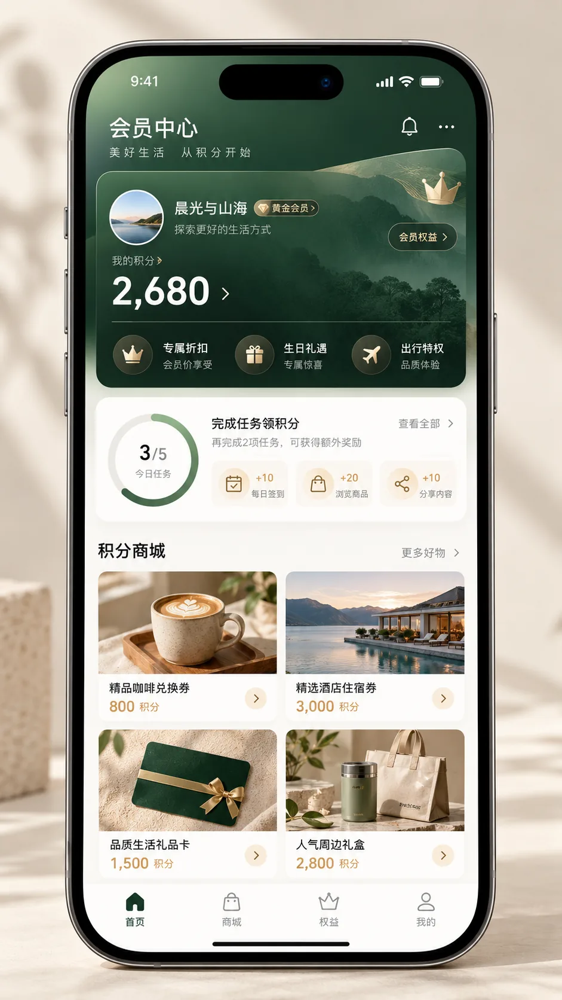

# UniApp 会员中心与积分商城

面向会员体系、积分任务、兑换商城的场景页 Skill。它是页面编排层，依赖现有主题、样式、组件和请求规范，不替代它们。

## 适用

- “做一个小程序会员中心”
- “做积分商城、每日任务、会员权益页”
- “把我的页面改成高质感会员页”

## 依赖顺序

`uniapp-standard-skill` → `uniapp-theme-skill` → `uniapp-style-skill` → `uniapp-page-components-skill` → `uniapp-request-skill` → 本 Skill。

## 目录

- `assets/member-center-premium-reference.png`：视觉方向参考
- `templates/member-center.vue`：Vue3 / UniApp 结构模板
- `references/acceptance.md`：上线前验收项
- `demo/screenshots/member-center-default.webp`：默认态展示图（已压缩，约 103 KB）

## Demo 截图

截图展示本 Skill 的目标信息层级：会员身份、积分、权益、任务与积分商城。它是高保真视觉 Demo，不是模板在特定业务项目中的实机截图；接入项目后必须使用真实主题 Token、真实数据和真实商品图片进行视觉回归。

## 边界

页面只处理通用结构与交互状态；会员等级规则、积分流水、兑换库存和支付规则由具体业务后端决定。

## 触发词

| 功能 | 触发词 |
|------|--------|
| 会员中心 | "会员中心"、"个人中心"、"我的" |
| 积分商城 | "积分商城"、"积分兑换"、"商品兑换" |
| 会员权益 | "会员权益"、"权益中心"、"VIP" |
| 每日签到 | "签到"、"每日任务"、"任务中心" |
| 会员等级 | "会员等级"、"等级体系"、"成长值" |
