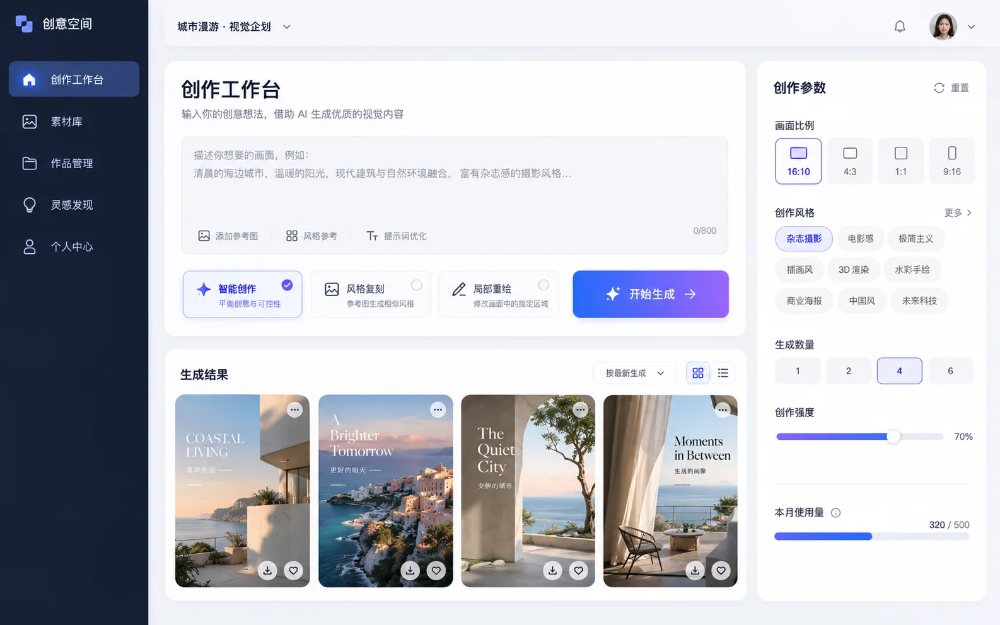

# Vue AI 创作工作台 Skill

面向 AI 内容创作产品的页面编排技能。它复用现有 Vue 组件与 Token，只负责把「创作意图、参数、生成状态、结果」组织成有视觉层级的工作台。



上图是明亮编辑感的视觉参考，不是浏览器运行截图。Skill 内有 3 个可打开的静态交互 Demo：

| variant | Demo | 设计参考图 |
|---|---|---|
| `editorial-light` | [明亮编辑感桌面工作台](demo-components/creative-workspace/html/01-creative-workspace.html) | [WebP](assets/creative-workspace-reference.webp) |
| `immersive-dark` | [沉浸暗色桌面工作台](demo-components/creative-workspace/html/02-immersive-dark.html) | [WebP](assets/creative-workspace-dark-reference.webp) |
| `mobile-inspiration` | [移动端灵感编辑器](demo-components/creative-workspace/html/03-mobile-inspiration-editor.html) | [WebP](assets/creative-workspace-mobile-reference.webp) |
| `storyboard-timeline` | [短片分镜创作台](demo-components/creative-workspace/html/04-storyboard-timeline.html) | [WebP](assets/storyboard-timeline-reference.webp) |

## 页面能力

- `editorial-light`：明亮三栏工作台，适合品牌与内容运营场景。
- `immersive-dark`：暗色沉浸创作台，适合专业图像与视觉生成场景。
- `mobile-inspiration`：单列拼贴编辑器，适合移动端收集灵感和轻创作。
- `storyboard-timeline`：分镜和时间线工作台，适合 AI 短片、广告脚本和视频预览。
- 结果画廊：展示生成中、完成、收藏等状态。
- 参数控制：比例、视觉风格、生成数量。
- 轻交互 Demo：切换模式和比例、编辑意图、模拟生成、收藏结果。

## 复用关系

```text
vue-ai-creative-workspace-skill
├─ vue-theme-skill       设计 Token
├─ vue-layout-skill      应用壳与导航
├─ vue-base-skill        base-card
├─ vue-input-skill       base-input
├─ vue-button-skill      base-button
├─ vue-tag-skill         base-tag
├─ vue-dropdown-skill    base-dropdown
└─ vue-dialog-skill      base-dialog / base-confirm
```

## 如何使用

1. 先在项目中加载 `vue-theme-skill` 的 Token。
2. 使用 `vue-layout-skill` 放置应用壳与左侧导航。
3. 根据选择的 Demo 使用对应模板：`AiCreativeWorkspace.vue`（明亮桌面）、`ImmersiveDarkWorkspace.vue`（暗色桌面）、`MobileInspirationEditor.vue`（移动端）、`StoryboardTimelineWorkspace.vue`（分镜时间线）。
4. 用 `frontend-request-skill` 封装任务创建与状态查询；页面只处理展示状态。

三个模板都复用 `base-card`、`base-input`、`base-button`、`base-tag`、`base-dropdown`；不是把静态 Demo 当作唯一实现来源。

## 不覆盖的范围

模型供应商、提示词安全、文件上传、任务队列、SSE、数据库和鉴权都属于业务层，不在本技能内实现。

## 触发词

| 风格 | 核心差异 | 触发词 |
|------|----------|--------|
| **明亮编辑感** | 明亮三栏、品牌物料、内容运营 | 默认、"创作工作台"、"明亮" |
| **沉浸暗色** | 深色沉浸、专业图像生成 | "dark"、"暗色"、"沉浸" |
| **移动灵感** | 单列拼贴、移动端灵感收集 | "移动"、"mobile"、"灵感" |
| **分镜时间线** | 视频分镜、时间线、镜头预览 | "分镜"、"timeline"、"时间线" |
